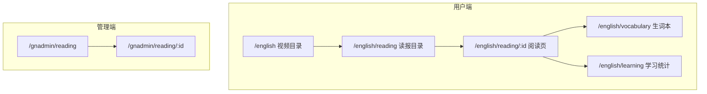
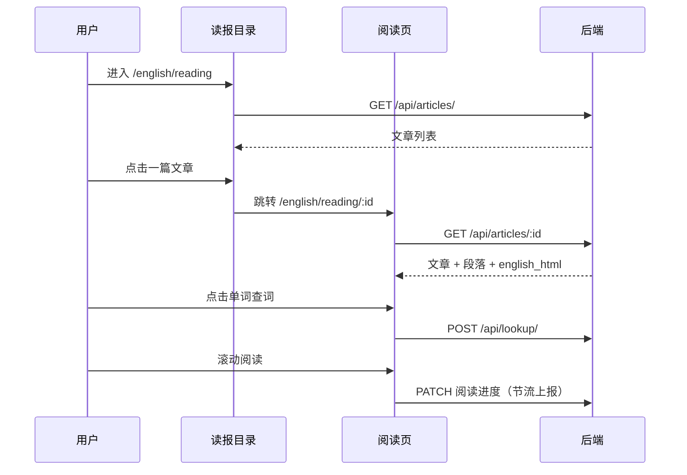
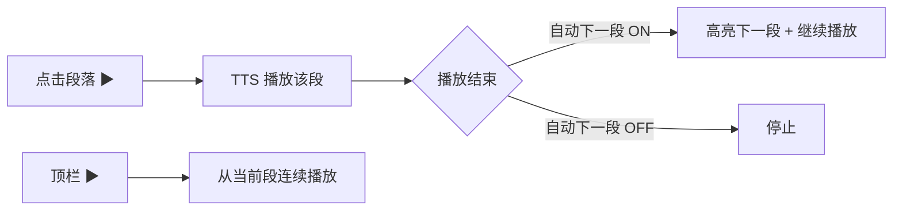

# News Reading 模块 · 产品方案（V1）

> 参考：[Language Reactor 阅读模式](https://www.languagereactor.com/c/en/uu/uu_all_en/ud_017b13962760)  
> 状态：产品方案草案 · 2026-07  
> 下一步：确认方案后进入技术方案（数据模型 + API）

---

## 1. 产品定位

### 1.1 一句话

**Vloglish News Reading** = 真实英文新闻/时文 + 句段级双语对照 + 点击查词 + 段落朗读，帮助用户在**无视频**场景下练阅读、积累新闻词汇。

### 1.2 与现有视频精听的关系

| 维度 | 视频精听（现有） | 英文读报（新增） |
|------|------------------|------------------|
| 核心能力 | 听力、口语节奏、跟读 | 阅读、书面语、新闻词汇 |
| 内容形态 | YouTube Vlog + 时间轴字幕 | 新闻/时文 + 句段对齐 |
| 学习单位 | 字幕句（秒级） | 段落块（句/段级） |
| 媒体 | 视频播放器 | TTS 朗读（可选预录音频） |
| 典型场景 | 通勤精听、跟读模仿 | 晨读、精读、考前阅读 |

两者共用：**账号体系、查词、生词本、学习统计、会员权限**，形成「听 + 读」双产品线。

### 1.3 目标用户

| 用户群 | 需求 | 读报模块价值 |
|--------|------|--------------|
| 雅思考生 | 练学术/新闻类阅读 | 正式语体、长句拆解 |
| 职场用户 | 读懂外媒、行业资讯 | 时事词汇、高效精读 |
| 视频精听用户 | 补足阅读短板 | 同一账号下查词/生词打通 |
| 自学者 | 每日固定阅读量 | 短篇新闻、进度可追踪 |

---

## 2. 信息架构（IA）

### 2.1 路由规划

```
/english                          → 视频目录（现有，可增加「读报」入口 Tab）
/english/reading                  → 读报目录（文章列表）
/english/reading/:articleId       → 阅读页（核心）
/english/vocabulary               → 生词本（扩展：来源含「读报」）
/english/learning                 → 学习统计（扩展：阅读时长/篇数）

/gnadmin/reading                  → 管理端：文章列表
/gnadmin/reading/new              → 新建文章
/gnadmin/reading/:id              → 编辑文章 / 段落 / 发布
```

### 2.2 导航入口

**方案 A（推荐 MVP）**：在顶部导航或 `/english` 首页增加 **「视频 | 读报」** 双 Tab，读报独立目录，不干扰现有视频首页。

**方案 B（后期）**：统一「学习」首页，视频与读报混排「继续学习」卡片。

MVP 采用 **方案 A**，改动小、认知清晰。

### 2.3 站点地图



---

## 3. 页面方案

### 3.1 读报目录页 `/english/reading`

**目标**：让用户快速找到想读的文章，并看到学习状态。

#### 布局（桌面 / Pad）

```
┌────────────────────────────────────────────────────────────┐
│  [视频]  [读报●]                    学习统计  生词本  用户  │
├────────────────────────────────────────────────────────────┤
│  读报                                                       │
│  真实英文新闻，句段对照精读                                  │
├────────────────────────────────────────────────────────────┤
│  [继续阅读 · 3]  ← 横向卡片（未完成文章）                    │
├────────────────────────────────────────────────────────────┤
│  筛选：来源 ▾  难度 ▾  日期 ▾  状态 ▾   🔍 搜索标题/关键词    │
├────────────────────────────────────────────────────────────┤
│  ┌──────────────┐  ┌──────────────┐  ┌──────────────┐      │
│  │ 封面/来源图标 │  │              │  │              │      │
│  │ 标题（2行）   │  │              │  │              │      │
│  │ CGTN · 7/5   │  │              │  │              │      │
│  │ ★★★ · 820词  │  │              │  │              │      │
│  │ [已读 60%]    │  │              │  │              │      │
│  └──────────────┘  └──────────────┘  └──────────────┘      │
│  … 无限滚动加载 …                                           │
└────────────────────────────────────────────────────────────┘
```

#### 布局（手机）

- 单列卡片列表（与视频卡片风格一致）
- 筛选收进底部 Sheet 或顶部横滑 Chip
- 「继续阅读」置于列表顶部

#### 列表卡片字段

| 字段 | 说明 |
|------|------|
| 标题 | 英文标题为主，可选副标题 |
| 来源 | 如 CGTN、BBC、新华社英文 |
| 发布日期 | 新闻日期 |
| 难度 | 1–5 星或 CEFR 标签（与视频 stars 一致） |
| 字数 | 约 X 词 / X 段 |
| 进度 | 未读 / 进行中 X% / 已读完 |
| 封面 | 可选；无封面时用来源品牌色块 |

#### 筛选维度（MVP）

| 维度 | 选项示例 |
|------|----------|
| 来源 | 全部 / CGTN / 新华社英文 / 自研 |
| 难度 | 全部 / ★1–5 |
| 学习状态 | 全部 / 未读 / 进行中 / 已读完 |
| 排序 | 最新发布 / 难度升序 |

搜索 MVP 仅支持**标题关键词**；全文搜索放入 Phase 2。

---

### 3.2 阅读页 `/english/reading/:articleId`（核心）

**目标**：句段级双语对照精读，支持查词、朗读、进度记录。

#### 布局（Pad / 桌面 · 双栏，参考 Language Reactor）

```
┌────────────────────────────────────────────────────────────┐
│  ← 返回    ▶ 播放    文章标题…              ⭐ 收藏   ⚙️   │
├────────────────────────────┬───────────────────────────────┤
│  EN                        │  ZH                           │
├────────────────────────────┼───────────────────────────────┤
│  ▶ BEIJING, July 5 …       │  北京，7月5日（新华社）——      │  ← 当前段（高亮底）
├────────────────────────────┼───────────────────────────────┤
│    A compilation of …      │    这是摘自……的汇编。          │
├────────────────────────────┼───────────────────────────────┤
│    The book contains …     │    该书收录了……                │
├────────────────────────────┼───────────────────────────────┤
│    …                       │    …                           │
└────────────────────────────┴───────────────────────────────┘
│  ◀ 上一段    ━━━━━●━━━━━    下一段 ▶    1.0x ▾            │  ← 底部朗读控制（可选）
└────────────────────────────────────────────────────────────┘
```

#### 布局（手机 · 单栏堆叠）

```
┌────────────────────────────┐
│  ←    ▶    标题…      ⚙️   │
├────────────────────────────┤
│  ┌──────────────────────┐  │
│  │ ▶ EN 句段             │  │
│  │   ZH 译文（可折叠）    │  │  ← 段落卡片
│  └──────────────────────┘  │
│  ┌──────────────────────┐  │
│  │   EN …                │  │
│  │   ZH …                │  │
│  └──────────────────────┘  │
│  … 滚动 …                   │
├────────────────────────────┤
│  ◀  ▶  ━━━●━━━  1.0x      │  ← 固定底栏（TTS）
└────────────────────────────┘
```

#### 段落块（Segment）交互

| 元素 | 行为 |
|------|------|
| 段落卡片 | 点击设为「当前段」，更新阅读进度 |
| 英文词 | 点击 → 查词弹层（复用 EntryCard） |
| 词汇高亮 | 按难度/生词状态着色（复用 english_html 逻辑） |
| ▶ 段落播放 | TTS 朗读该段英文 |
| 顶栏 ▶ | 从当前段起连续朗读至文末 |
| 当前段高亮 | 背景加深 + 滚动自动定位到视区中部 |

#### 翻译显示模式（MVP 做 2 种，Settings 切换）

| 模式 | 说明 | 默认 |
|------|------|------|
| 双语对照 | 左/上 EN，右/下 ZH | ✅ 默认 |
| 仅英文 | 隐藏译文，点击段落显示中文 | |

Phase 2 增加：**点击显示译文**、**长按显示译文**（手机）。

#### 顶栏功能（MVP）

| 按钮 | 功能 |
|------|------|
| ← 返回 | 回到读报目录 |
| ▶ / ⏸ | 全局 TTS 播放/暂停 |
| ⭐ | 收藏文章 |
| ⚙️ | 阅读设置（翻译模式、字体大小、TTS 倍速） |

#### 阅读设置（Sheet / 抽屉）

- 译文字号 / 英文字号（小、中、大）
- 翻译模式（双语 / 仅英文）
- TTS 倍速（0.75 / 1.0 / 1.25）
- 自动滚动跟随朗读（开/关）

---

### 3.3 查词弹层（复用 + 扩展）

复用现有 `EntryCard`，扩展上下文来源：

| 字段 | 视频场景 | 读报场景 |
|------|----------|----------|
| context | 字幕句英文 | 段落英文 |
| source | video_id + subtitle_id | article_id + segment_id |
| 跳转 | 「回到视频该句」 | 「回到读报该段」 |

生词本增加 **来源类型** 标签：`视频` / `读报`。

---

### 3.4 生词本 / 学习统计（增量）

#### 生词本 `/english/vocabulary`

- 筛选：来源 = 全部 / 视频 / 读报
- 卡片展示来源文章标题，点击跳转阅读页对应段落

#### 学习统计 `/english/learning`

新增指标（与视频并列展示）：

| 指标 | 说明 |
|------|------|
| 本周阅读篇数 | 打开并完成 ≥80% 的文章数 |
| 阅读时长 | 阅读页停留时间（有效阅读） |
| 读报查词数 | 来源为读报的 lookup 次数 |
| 日历热力图 | 视频 + 阅读合并或分色显示 |

---

### 3.5 管理端 `/gnadmin/reading`

**目标**：编辑、预览、发布读报内容。

#### 文章列表

- 标题、来源、状态（draft / published）、段落数、字数、发布日期
- 操作：编辑、预览、发布/下架、删除

#### 文章编辑页

```
┌─ 基本信息 ─────────────────────────────────────┐
│ 标题、来源、原文 URL、发布日期、难度、封面、标签  │
├─ 正文编辑 ─────────────────────────────────────┤
│ [导入] 粘贴原文 / 上传 TXT / URL 抓取（Phase 2）│
│ [一键处理] 自动分句 → 机翻 → 词汇分析           │
├─ 段落列表（可拖拽排序）─────────────────────────│
│  #1  EN: …     ZH: …     [编辑] [试听 TTS]      │
│  #2  EN: …     ZH: …     [编辑] [试听 TTS]      │
├─ 操作 ─────────────────────────────────────────│
│  [保存草稿]  [预览]  [发布]                      │
└────────────────────────────────────────────────┘
```

MVP 管理端支持：**手动录入 + 粘贴原文 + 自动分句/机翻/词汇分析**，不做自动爬虫。

---

## 4. 核心用户流程

### 4.1 首次阅读



### 4.2 继续阅读

- 目录页顶部「继续阅读」展示 `last_segment_index > 0` 且未完成的文章
- 进入阅读页自动滚动到上次段落并高亮

### 4.3 朗读流程



---

## 5. 功能优先级

### P0 · MVP（第一版必做）

| 模块 | 功能 |
|------|------|
| 目录 | 文章列表、分页、来源/难度/状态筛选 |
| 阅读 | 句段双语对照（桌面双栏 / 手机单栏） |
| 查词 | 点击查词、加入生词本、来源标记读报 |
| 高亮 | 段落词汇难度高亮（复用 analyze 管线） |
| 进度 | 记录当前段落索引、完成度、续读 |
| 管理 | 文章 CRUD、段落编辑、草稿/发布 |
| 导入 | 粘贴英文原文 → 自动分句 + 机翻 + 词汇分析 |
| 权限 | 会员全文；非会员限 N 篇（见 §6） |

### P1 · 体验增强（第二版）

| 功能 | 说明 |
|------|------|
| TTS 朗读 | 段落播放 + 顶栏连续播放 + 倍速 |
| 翻译模式 | 仅英文 / 点击显示中文 |
| 收藏 | 文章收藏列表 |
| 阅读设置 | 字号、自动滚动跟随 |
| 学习统计 | 阅读时长、篇数、日历 |
| 生词本 | 按来源筛选、跳回段落 |

### P2 · 规模化（第三版）

| 功能 | 说明 |
|------|------|
| RSS / URL 导入 | 自动抓取新闻正文 |
| 全文搜索 | 搜词搜句 |
| 闪卡复习 | 读报生词纳入复习 |
| 听写模式 | 隐藏英文，听 TTS 填词 |
| 专题/合集 | 「时事一周」「科技精选」 |

### 明确不做（MVP 范围外）

- 用户投稿文章（可 Phase 2 参考 SubmitEpisode）
- 社区评论、划线分享
- 多语言界面（读报内容仍 EN↔ZH）
- 离线阅读
- 原生 App（先做 Web 响应式）

---

## 6. 权限与商业化

### 6.1 与现有会员体系对齐

| 用户类型 | 视频（现有） | 读报（建议） |
|----------|--------------|--------------|
| 未登录 | 8 期预览 | 3 篇预览 |
| 登录非会员 | 8 期 | 5 篇 / 月 |
| 会员 | 全部 | 全部 |

具体数字可在上线前 A/B；**MVP 建议：会员全开放，非会员可读 5 篇**，与视频逻辑一致，降低理解成本。

### 6.2 试读策略

- 未登录/非会员点击第 N+1 篇 → 引导登录 / 激活会员
- 单篇试读：允许读前 30% 段落，后续段落模糊 + 付费引导（Phase 2）

---

## 7. 内容策略

### 7.1 内容来源（MVP）

| 优先级 | 来源 | 方式 |
|--------|------|------|
| P0 | 管理员精选 | 手动粘贴 + 编辑译文 |
| P0 | 新华社 / CGTN 英文稿 | 人工选稿 + 合规审核 |
| P1 | RSS（BBC Learning English 等） | 半自动导入 + 人工审核 |
| P2 | 用户投稿 | 审核流 |

### 7.2 单篇规格建议

| 项 | 建议 |
|----|------|
| 长度 | 300–800 词（3–8 分钟阅读量） |
| 段落数 | 8–20 段 |
| 分句规则 | 按句号/分号拆分；长句不超过 2 行（约 25 词） |
| 更新频率 | MVP 每周 3–5 篇；稳定后每日 1 篇 |

### 7.3 内容标签

- **来源**：CGTN、Xinhua、BBC、自研
- **主题**：时政、科技、财经、文化、体育
- **难度**：stars 1–5（与视频一致）

---

## 8. 非功能需求

| 项 | 要求 |
|----|------|
| 性能 | 阅读页首屏 < 1.5s；段落列表虚拟滚动（>30 段） |
| 响应式 | 手机 / Pad / 桌面；手机优先 |
| 无障碍 | 段落可键盘聚焦；TTS 可替代纯视觉 |
| SEO | 读报目录/详情可 SSR 或预渲染（Phase 2） |
| 版权 | 注明原文链接与来源；仅收录允许转载或已授权内容 |

---

## 9. 成功指标（上线后 4 周）

| 指标 | 目标（可调） |
|------|--------------|
| 读报 DAU 渗透率 | ≥ 20% 的活跃会员至少打开 1 次 |
| 篇均阅读完成率 | ≥ 40% 读至 80% 以上 |
| 篇均查词数 | ≥ 3 次（说明精读而非扫读） |
| 7 日留存 | 读过报用户 ≥ 视频-only 用户 |
| 内容供给 | MVP 上线时 ≥ 15 篇种子文章 |

---

## 10. 产品决策（已确认 · 2026-07-06）

| # | 问题 | 决策 |
|---|------|------|
| 1 | 导航入口 | ✅ Tab「视频 \| News Reading」 |
| 2 | 非会员可读篇数 | ✅ 5 篇 / 月 |
| 3 | MVP 是否含 TTS | ✅ 不含；P1 再上完整朗读 |
| 4 | 手机默认翻译模式 | ✅ 双语对照 |
| 5 | 译文来源 | ✅ 机翻 + 重点篇人工校对 |
| 6 | 「继续学习」与视频 | ✅ MVP 分开展示 |
| 7 | 模块对外名称 | ✅ **News Reading** |

---

## 11. 里程碑建议

| 阶段 | 周期（估） | 交付 |
|------|------------|------|
| M0 方案确认 | 1 周 | 本文档定稿 + 技术方案 |
| M1 MVP 开发 | 3–4 周 | 目录 + 阅读 + 查词 + 管理 + 15 篇内容 |
| M2 体验版 | 2 周 | TTS + 设置 + 统计 + 收藏 |
| M3 内测 | 1 周 | 会员小范围试用，收集反馈 |
| M4 公测 | — | 全量会员开放读报 Tab |

---

## 12. 下一步

1. ~~确认 §10 待确认事项~~ ✅ 已完成
2. **进行中** 技术方案：见 [`READING_MODULE_TECH.md`](./READING_MODULE_TECH.md)
3. **原型**（可选）：阅读页 Figma 或前端静态原型
4. **种子内容**：整理 10–15 篇 CGTN/新华社英文稿作为上线内容

---

*文档维护：产品方案 v1 · 随评审更新*
