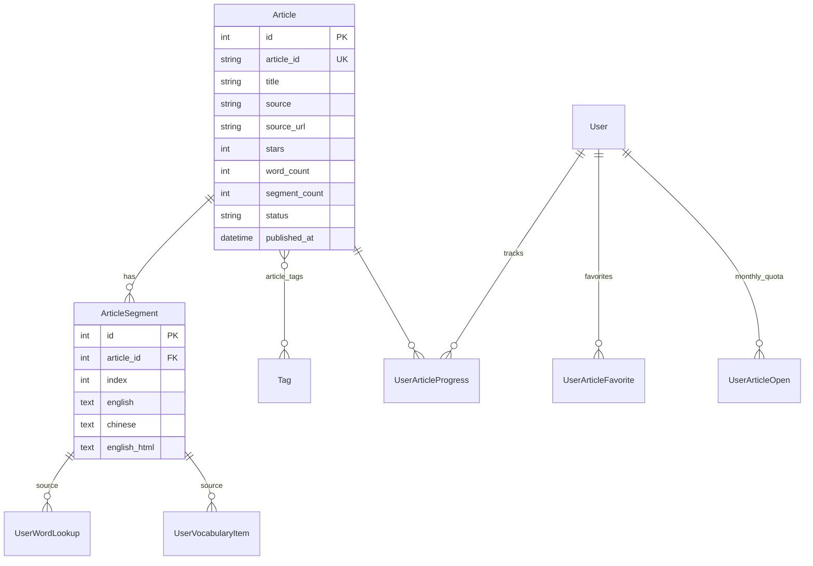

# News Reading 模块 · 技术方案（MVP）

> 产品方案：[`READING_MODULE_PRODUCT.md`](./READING_MODULE_PRODUCT.md)（决策已确认）  
> 状态：技术草案 v1 · 2026-07-06  
> MVP 范围：**不含 TTS**；手机默认双语；非会员 5 篇/月

---

## 1. 已确认产品决策（摘要）

| 项 | 决策 |
|----|------|
| 导航 | Tab「Videos \| News Reading」 |
| 对外名称 | **News Reading** |
| 非会员额度 | 登录用户 **5 篇 / 自然月**；未登录 **3 篇**（与视频 8 期逻辑类似） |
| MVP | **不含 TTS**（阅读页预留播放 UI 位，P1 接入） |
| 手机默认 | 双语对照 |
| 译文 | 机翻 + 重点篇人工校对 |
| 继续学习 | 与视频 **分开展示** |

---

## 2. 架构总览

```
┌─────────────────────────────────────────────────────────────┐
│  Frontend (Vue 3)                                           │
│  NewsReadingListPage / NewsReadingPage / AdminReading*      │
│  复用：EntryCard、subtitleHtml、auth、axios                 │
└───────────────────────────┬─────────────────────────────────┘
                            │ /api/articles/*
                            │ /api/admin/articles/*
┌───────────────────────────▼─────────────────────────────────┐
│  Backend (FastAPI)                                          │
│  routers/articles.py · routers/admin/articles.py            │
│  services/article_*.py · article_access.py                    │
└───────────────────────────┬─────────────────────────────────┘
                            │
┌───────────────────────────▼─────────────────────────────────┐
│  PostgreSQL / SQLite                                        │
│  articles · article_segments · user_article_progress · …    │
└─────────────────────────────────────────────────────────────┘
```

**设计原则**：新建独立 `Article` 模型，**不扩展** `Episode`；查词 / 生词 / 词汇高亮 **复用现有管线**，通过 nullable 外键扩展来源。

---

## 3. 数据模型

### 3.1 ER 关系



### 3.2 `articles` 表

| 字段 | 类型 | 说明 |
|------|------|------|
| `id` | int PK | 内部 ID |
| `article_id` | string(32) UK | 对外 ID（opaque，生成规则同 `video_id`） |
| `title` | string(512) | 英文标题 |
| `summary` | text | 可选摘要（列表展示） |
| `source` | string(64) | 来源名，如 `CGTN`、`Xinhua` |
| `source_url` | text | 原文链接 |
| `topic` | string(64) | 主题：`politics` / `tech` / `culture` … |
| `cover` | text | 封面 URL（可选） |
| `stars` | int | 难度 1–5（与 Episode 一致） |
| `word_count` | int | 总词数（导入时计算） |
| `segment_count` | int | 段落数 |
| `status` | string(16) | `draft` / `published` / `archived` |
| `is_free_preview` | bool | 是否计入未登录试读池（默认 false） |
| `published_at` | datetime | 新闻日期 / 发布时间 |
| `created_at` | datetime | 入库时间 |
| `updated_at` | datetime | 最后编辑 |

索引：`(status, published_at DESC)`、`article_id`

### 3.3 `article_segments` 表

| 字段 | 类型 | 说明 |
|------|------|------|
| `id` | int PK | |
| `article_id` | int FK | |
| `index` | int | 从 0 起，有序 |
| `english` | text | 英文句段 |
| `chinese` | text | 中文译文 |
| `english_html` | text | 词汇高亮 HTML（复用 Subtitle 字段语义） |

唯一约束：`(article_id, index)`

**与 Subtitle 的差异**：无 `start` / `end` / `ipa`（MVP 不需要 IPA；P2 可加）。

### 3.4 `article_tags` 关联表（可选 MVP）

复用现有 `tags` 表：

```python
article_tags = Table(
    "article_tags",
    Base.metadata,
    Column("article_id", ForeignKey("articles.id"), primary_key=True),
    Column("tag_id", ForeignKey("tags.id"), primary_key=True),
)
```

MVP 若主题较少，可仅用 `articles.topic` 字符串，P1 再接入 Tag 多选。

### 3.5 `user_article_progress` 表

| 字段 | 类型 | 说明 |
|------|------|------|
| `user_id` | int FK | |
| `article_id` | int FK | |
| `last_segment_index` | int | 当前读到的段落 |
| `max_reached_index` | int | 最远读到的段落 |
| `read_time_sec` | int | 累计阅读时长（MVP 可简化为前端上报） |
| `completion_percent` | float | `max_reached / segment_count` |
| `is_completed` | bool | ≥ 80% 视为读完 |
| `first_opened_at` | datetime | |
| `last_read_at` | datetime | |
| `completed_at` | datetime | nullable |

唯一约束：`(user_id, article_id)`

### 3.6 `user_article_favorites` 表

| 字段 | 类型 | 说明 |
|------|------|------|
| `user_id` | int FK | |
| `article_id` | int FK | |
| `created_at` | datetime | |

唯一约束：`(user_id, article_id)` — P1 收藏功能；MVP 表可先建，API 后补。

### 3.7 `user_article_opens` 表（月度额度）

非会员 **5 篇/月** 需记录「本月已打开的文章」：

| 字段 | 类型 | 说明 |
|------|------|------|
| `id` | int PK | |
| `user_id` | int FK | nullable（未登录用 device_id） |
| `device_id` | string(64) | 未登录时标识设备 |
| `article_id` | int FK | |
| `opened_at` | datetime | |

索引：`(user_id, opened_at)`、`(device_id, opened_at)`

**额度规则**：

```python
GUEST_ARTICLE_LIMIT = 3          # 未登录，按 device_id 累计（全站 published 中先打开的 3 篇）
MEMBER_ARTICLE_LIMIT = None      # 会员无限制
NON_MEMBER_MONTHLY_LIMIT = 5     # 登录非会员，自然月内 distinct article_id
```

`can_access_article(user, article)` 逻辑：

1. `status != published` → 403（管理预览除外）
2. `user.is_member` → 允许
3. 已存在该用户的 `user_article_progress` 或 `user_article_opens`（本篇本月已开）→ 允许重读
4. 未登录：本篇 `article_id` 在 device 已打开的 3 篇内，或本月打开数 < 3
5. 登录非会员：本篇在本月已打开 5 篇内，或本月 distinct 打开数 < 5
6. 否则 → 403 + `{ code: "article_limit_reached", limit: 5 }`

### 3.8 扩展现有查词 / 生词表

**`user_word_lookups`** 新增 nullable 字段：

| 字段 | 类型 |
|------|------|
| `article_id` | int FK nullable |
| `segment_id` | int FK nullable |

**`user_vocabulary_items`** 新增：

| 字段 | 类型 |
|------|------|
| `source_article_id` | int FK nullable |
| `source_segment_id` | int FK nullable |
| `source_type` | string(16) default `video` | `video` / `article` |

迁移时对旧数据 `source_type = 'video'`，无需回填。

**Lookup API** 扩展 query 参数：

```
GET /api/lookup/?word=...&context=...&article_id=...&segment_id=...
```

`video_id` / `subtitle_id` 与 `article_id` / `segment_id` 互斥，后端校验。

---

## 4. API 设计

### 4.1 用户端 `/api/articles`

#### `GET /api/articles/`

文章列表（目录页）。

Query：

| 参数 | 说明 |
|------|------|
| `page` / `page_size` | 分页，默认 20 |
| `source` | 来源筛选 |
| `topic` | 主题筛选 |
| `stars` | 难度 |
| `status` | 固定 `published`（用户端） |
| `ordering` | `-published_at`（默认）/ `stars` |
| `q` | 标题关键词（MVP） |

Response：

```json
{
  "count": 42,
  "next": "?page=2",
  "results": [
    {
      "article_id": "a3k9m2x7p1q4r8s",
      "title": "Xi's discourses on community-level work published",
      "source": "Xinhua",
      "topic": "politics",
      "stars": 4,
      "word_count": 620,
      "segment_count": 14,
      "published_at": "2026-07-05T00:00:00Z",
      "cover": "https://...",
      "progress": {
        "last_segment_index": 5,
        "completion_percent": 42.8,
        "is_completed": false
      },
      "accessible": true
    }
  ],
  "quota": {
    "is_member": false,
    "monthly_limit": 5,
    "opened_this_month": 2,
    "remaining": 3
  }
}
```

未登录用户 `quota` 返回 guest 规则。

#### `GET /api/articles/continue/`

继续阅读列表（独立接口，与视频 `recent` 分开）。

```json
{
  "results": [
    {
      "article_id": "...",
      "title": "...",
      "source": "CGTN",
      "completion_percent": 60,
      "last_read_at": "..."
    }
  ]
}
```

条件：`!is_completed && last_segment_index > 0`，按 `last_read_at DESC`，limit 5。

#### `GET /api/articles/{article_id}/`

文章详情 + 全部分段（阅读页）。

Response：

```json
{
  "article_id": "...",
  "title": "...",
  "source": "Xinhua",
  "source_url": "https://...",
  "topic": "politics",
  "stars": 4,
  "word_count": 620,
  "published_at": "...",
  "segments": [
    {
      "id": 101,
      "index": 0,
      "english": "BEIJING, July 5 (Xinhua) --",
      "chinese": "北京，7月5日（新华社）——",
      "english_html": "<span>BEIJING</span>, ..."
    }
  ],
  "progress": {
    "last_segment_index": 3,
    "completion_percent": 21.4,
    "is_completed": false
  }
}
```

**权限**：调用时写入 `user_article_opens`（首次打开计额度）；无权限返回 403。

#### `PATCH /api/articles/{article_id}/progress/`

更新阅读进度（节流，前端每 5s 或段落切换时上报）。

Body：

```json
{
  "last_segment_index": 7,
  "read_time_delta_sec": 5
}
```

#### `GET /api/articles/filters/`

返回 `{ sources: [...], topics: [...], stars_range: [1,5] }` 供筛选器使用。

---

### 4.2 管理端 `/api/admin/articles`

| 方法 | 路径 | 说明 |
|------|------|------|
| GET | `/api/admin/articles/` | 列表（含 draft） |
| POST | `/api/admin/articles/` | 创建空文章 |
| GET | `/api/admin/articles/{id}/` | 详情（内部 id 或 article_id） |
| PATCH | `/api/admin/articles/{id}/` | 更新元数据 |
| DELETE | `/api/admin/articles/{id}/` | 删除（级联 segments） |
| PUT | `/api/admin/articles/{id}/segments/` | 全量替换段落（同 subtitle replace） |
| POST | `/api/admin/articles/{id}/import-text/` | 粘贴原文 → 分句 + 机翻 + 分析 |
| POST | `/api/admin/articles/{id}/analyze/` | 仅重新跑词汇高亮 |
| POST | `/api/admin/articles/{id}/publish/` | 发布 |

#### `POST .../import-text/`

Body：

```json
{
  "english_text": "BEIJING, July 5 ...",
  "auto_translate": true,
  "auto_analyze": true
}
```

Pipeline：

```
english_text
  → split_into_segments()      # 规则分句 + 长句拆分
  → translate_segments()       # DeepSeek / 现有翻译（待选）
  → analyze_segments()         # 复用 annotate_subtitle_lines_with_deepseek
  → 写入 article_segments + 更新 word_count / segment_count / stars
```

---

## 5. 内容处理管线

### 5.1 分句 `split_into_segments(text) -> list[str]`

规则（MVP，不依赖 NLP 库）：

1. 按 `. ` / `? ` / `! ` 拆分，保留标点
2. 合并过短片段（< 20 字符）与下一句
3. 过长片段（> 180 字符或 > 25 词）在 `, ; —` 处二次拆分
4. 保留 `BEIJING, July 5 (Xinhua) --` 类 dateline 为独立段

### 5.2 机翻 `translate_segments(segments) -> list[str]`

新建 `services/article_translate.py`：

- 输入：英文句段列表
- 输出：中文列表（与 index 对齐）
- 实现：DeepSeek chat（批量，每批 10 句）或现有内部翻译接口
- 管理端编辑页支持 **人工覆盖** 单段 `chinese`

### 5.3 词汇分析

直接复用 `subtitle_analyze.py`：

```python
def analyze_article_segments(segments: list[dict]) -> dict:
    # segments: [{ "english": "...", "chinese": "..." }, ...]
    return analyze_subtitles_with_deepseek(segments, clip_length=None)
```

输出：`english_html`、`stars`、`voca_size`（映射为 `word_count` 辅助）、`highlight_count`。

---

## 6. 权限模块 `article_access.py`

```python
GUEST_ARTICLE_LIMIT = 3
NON_MEMBER_MONTHLY_LIMIT = 5

def can_access_article(db, article, user, device_id: str) -> bool: ...
def record_article_open(db, article, user, device_id) -> None: ...
def get_article_quota(db, user, device_id) -> dict: ...
def list_accessible_article_ids(db, user, device_id) -> set[int]: ...
```

与 `demo_access.py` 并列，**不修改**现有 episode 逻辑。

---

## 7. 前端结构

### 7.1 路由

```typescript
// router/index.ts
{ path: 'english/reading', name: 'NewsReadingList', component: NewsReadingListPage },
{ path: 'english/reading/:articleId', name: 'NewsReading', component: NewsReadingPage, meta: { immersive: true } },
```

### 7.2 导航 Tab

在 `DefaultLayout.vue` 或 `HomePage` 顶部增加 Tab 切换（仅 `/english` 与 `/english/reading` 路由下显示）：

```
[ Videos ]  [ News Reading ]
```

### 7.3 页面与组件

```
pages/
  NewsReadingListPage.vue       # 目录 + 筛选 + 继续阅读
  NewsReadingPage.vue           # 阅读页（immersive）

components/reading/
  ReadingSegmentBlock.vue       # 单段双语卡片
  ReadingSegmentEnglish.vue     # 英文 + english_html 渲染（复用 SubtitleEnglish 逻辑）
  ReadingSegmentChinese.vue     # 中文
  ReadingProgressBar.vue        # 阅读进度（顶部细条，非 TTS）
  ReadingFilters.vue            # 筛选（仿 CatalogFilters）
  ContinueReadingStrip.vue      # 继续阅读横滑

composables/
  useReadingProgress.ts         # 进度上报、当前段高亮
  useArticleAccess.ts           # 额度提示

api/
  articles.ts                   # list / detail / progress / continue
```

### 7.4 阅读页布局逻辑

| 断点 | 布局 |
|------|------|
| `< lg`（手机） | 单栏：段落卡片，EN 上 / ZH 下，默认双语 |
| `≥ lg` | 双栏：左 EN / 右 ZH，段间 horizontal 对齐 |

**复用**：

- `subtitleHtml.ts` → 渲染 `english_html`
- `EntryCard.vue` → 查词弹层，传 `article_id` + `segment_id`
- `useMobilePlayerChrome` → **不用**（无视频）

**MVP 不含 TTS**：顶栏 ▶ 按钮 disabled 或隐藏；段落 ▶ 不渲染。

### 7.5 管理端

```
pages/admin/
  AdminReadingListPage.vue
  AdminReadingEditPage.vue      # 元数据 + 段落列表 + 导入文本
```

Admin 路由挂到现有 `AdminLayout` 侧边栏：**News Reading** 菜单项。

---

## 8. Serializer 示例

```python
# serializers/article_detail.py
def article_list_item(article, progress=None, accessible=True) -> dict: ...
def article_detail(article, segments, progress=None) -> dict: ...
def article_segment(seg) -> dict:
    return {
        "id": seg.id,
        "index": seg.index,
        "english": seg.english,
        "chinese": seg.chinese,
        "english_html": seg.english_html or "",
    }
```

---

## 9. 数据库迁移

1. 新增表：`articles`、`article_segments`、`user_article_progress`、`user_article_favorites`、`user_article_opens`
2. ALTER `user_word_lookups`：+ `article_id`、`segment_id`（nullable FK）
3. ALTER `user_vocabulary_items`：+ `source_article_id`、`source_segment_id`、`source_type`
4. 在 `main.py` `_migrate_schema()` 中加入 ALTER 语句（与现有增量迁移方式一致）

**ID 生成**：复用 `video_id` 生成工具或新函数 `generate_article_id()` → 15 位 `[a-z0-9]`。

---

## 10. MVP 开发任务拆分

### Backend（约 1.5 周）

| # | 任务 |
|---|------|
| B1 | models + migration |
| B2 | `article_access.py` 额度逻辑 |
| B3 | `GET/POST` 用户端 articles API |
| B4 | progress PATCH + continue |
| B5 | lookup / vocabulary 扩展 |
| B6 | admin CRUD + import-text + analyze |
| B7 | `split_into_segments` + translate + analyze 管线 |

### Frontend（约 1.5 周）

| # | 任务 |
|---|------|
| F1 | 路由 + Tab 导航 |
| F2 | `NewsReadingListPage` + API |
| F3 | `NewsReadingPage` 双栏/单栏 |
| F4 | 查词对接 EntryCard |
| F5 | 进度上报 + 继续阅读 |
| F6 | 额度用尽提示 / 会员引导 |
| F7 | Admin 列表 + 编辑 + 导入 |

### Content（并行）

| # | 任务 |
|---|------|
| C1 | 录入 15 篇种子文章 |
| C2 | 重点篇人工校对译文 |

---

## 11. P1 预留（本方案不实现）

| 项 | 预留方式 |
|----|----------|
| TTS | `article_segments.audio_url` 字段可 P1 再加；前端顶栏/段落 ▶ 占位 |
| 收藏 | 表已建，API + UI P1 |
| 阅读统计 | `read_time_sec` 字段已建；LearningPage 扩展 P1 |
| 仅英文模式 | 阅读页 Settings composable 预留 `translationMode` |
| 全文搜索 | 列表 `q` 先标题；P2 加 segment 全文索引 |

---

## 12. 风险与对策

| 风险 | 对策 |
|------|------|
| 机翻质量不稳定 | 管理端逐段可编辑；重点篇人工校对 |
| 分句断句不准 | 管理端拖拽/合并/拆分段落（P1）；MVP 手动微调 |
| 额度 bypass | 服务端 `can_access_article` 强制校验；opens 表审计 |
| 版权 | `source_url` 必填；仅收录授权/公开内容 |
| 与 Episode 混淆 | 独立路由、独立 API 前缀、查词 `source_type` 区分 |

---

## 13. 下一步

1. 评审本技术方案  
2. 启动 **B1 models + B3 列表 API** 与 **F1 路由 Tab** 并行  
3. 准备 15 篇种子内容（C1）  

---

*文档维护：技术方案 v1 · 随实现更新*
